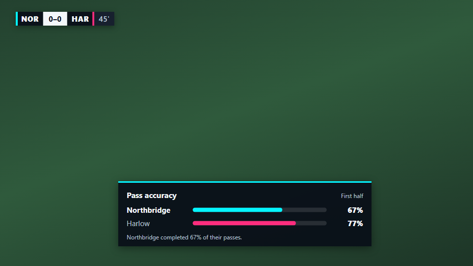
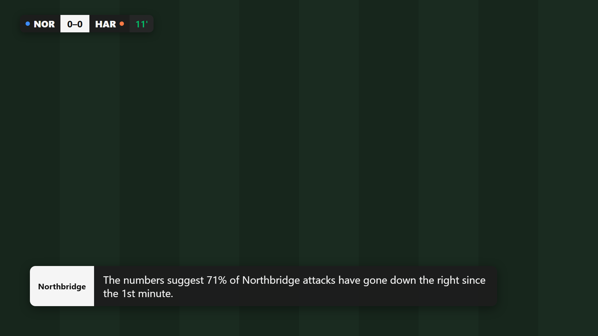

# PitchSide

[](https://github.com/AmalAbdirahman/PitchSide/actions/workflows/test.yml)

A producer-first control room for a replayed, synthetic football match. Python builds a replay bundle offline; a static web page in `docs/` replays it. An LLM agent drafts claims at build time, a second agent reads each sentence back, deterministic code verifies every one, risk tiers decide what airs on its own and what a human must approve, and each approved fact becomes a broadcast graphic (lower third, stat comparison, player card or ticker) for a clean program output, English and Spanish captions, and an audio script.

## Honesty first

- **Synthetic data on the site.** The published replay's clubs (Northbridge, Harlow), players and events come from a seeded simulator. No real match data, names or logos are on the site.
- **Real open data, locally only.** The pipeline also runs on a real match from StatsBomb Open Data (rule-based drafter, no agent). Raw files and the built bundle stay in git-ignored folders and are not published, because StatsBomb's user agreement does not allow redistributing the data. See `data_sources.md` for the licence, every mapping decision and the dropped event types.
- **The site is a replay.** The published page replays a pre-built bundle. It has no server and makes no network calls. A live mode exists only as a local `docker compose` stack (below); it is not deployed.
- **The model runs at build time, or on your own machine.** Drafts for each moment come from the Scout, a prompt agent on Microsoft Foundry, called by `python -m app.build_bundle --foundry`. Its answers are cached in `data/agent_cache.json`, so the normal build and the site never call a model. The one exception is Ask PitchSide's live mode, a server you start yourself on 127.0.0.1 (below).
- **The Scout uses structured output, and tools in explore mode.** Its reply must follow a JSON Schema generated from Pydantic models. In explore mode it gets no numbers, only the match state and a flagged moment, and finds numbers and evidence with three read-only tools backed by the metric registry (`list_metrics`, `compute_metric`, `list_events`), which cannot see past the moment. Measured in a live run on 2026-11-13: handed mode 36/38 claims passed first time and none was rejected; explore mode 24/38 first time and 7/38 still rejected after a retry, all for wrongly written numbers that the verifier caught (`docs/methods/scout.md`). The site uses handed mode.
- **A two-agent pipeline, with code as the judge.** A second agent, the Reader, sees only each Scout sentence and the roster and writes down the claim it understood; code compares that with the Scout's claim, and a mismatch fails the verifier's `meaning_matches` check and sends the Scout back once. On 75 hand-labelled sentences (34 with the right numbers but the wrong meaning) the check flagged 27 of the 34 (recall 0.79) and 4 of the 41 correct ones (precision 0.87), in one live run on 2026-11-13 (`docs/methods/meaning.md`). It misses qualifiers such as "on target" or "conceded". Neither agent decides what airs.
- **Ask PitchSide live mode: typed questions, on your machine only (R6).** `scripts/ask_server.py` is a small standard-library server bound to 127.0.0.1. It takes one question at a time (at most 200 characters, 30 s limit) together with the page's replay time, runs the same Analyst and the same checks, retry and refusal as the suggested answers, and returns the same answer shape. Live answers are not cached. The page makes no request to it until you click **Live (local)**; then it asks `/health`, enables the box if the server answers, and otherwise says how to start it. The server answers only the origins listed in `config.yaml` (`ask.live.allowed_origins`) and the page never holds a key. Tested with a mocked Analyst (`tests/test_ask_live.py`) and in Chromium (`pytest -m e2e`). **It has not yet been run against Foundry**, so no live answer from the real model has been seen.
- **Ask PitchSide: suggested answers built and checked at build time.** `data/ask_questions.json` holds seven questions about the replayed match, each asked at a set replay minute; one (distance run) needs data the event log does not hold. With `--foundry`, a third agent, the Analyst (a Foundry prompt agent), answers each with the Scout's three read-only tools, capped at that minute, and returns structured output: the answer text, every number with the tool call and field it came from, and evidence event ids. Code then checks the answer (`app/ask_checks.py`): every number in the text is listed and equals its tool call's output at the precision written, every player and team named is behind one of the answer's numbers or cited events, not merely somewhere in the calls (misspelt names fail), no call looks past the question's minute, and every evidence id came back from a call. A failed answer goes back once with the reasons; a second failure, or a question the tools cannot answer, is stored as "I can't verify that from the event log" plus the latest related verified fact, if there is one. Requests, responses and tool calls are cached in `data/ask_cache.json`; the normal build replays them (re-running each tool call) and writes `docs/data/ask.json`, which the page only reads. **The Analyst has not been run yet**, so the cache is empty and every suggested answer on the site currently says it was not built; this changes only after a `--foundry` build. Each question opens in the panel when the replay clock reaches its minute, and the Audit view lists each build-time attempt with its checks. On the public site the free-text box stays disabled; typed questions run only on your own machine (next item).
- **Template wording for T0.** Goals, substitutions and cards air at once, so they use fixed templates; agent wording is used only for facts that pass through a veto window or a producer (T1/T2).
- **Code decides truth.** A deterministic verifier recomputes every claim from the event log before it can air. The Scout's words are not trusted.
- **Injected errors are test cases.** Six drafts with planted errors (wrong number, player, window, a future event, an intent word, a small-sample overclaim) come from a rule-based drafter, not from the model. They exist so the verifier has something to catch; they say nothing about how any model behaves.
- **Spanish is unreviewed.** It comes from templates and a small glossary and has not been checked by a native speaker.
- **xG is a fitted model estimate.** A logistic regression fitted on StatsBomb Open Data shots from four men's international tournaments and validated on held-out matches: log loss 0.2655 against 0.2442 for StatsBomb's own xG and 0.3200 for a constant (`docs/methods/xg.md`). The simulator uses it. Real StatsBomb shots carry StatsBomb's own xG by default, since it scored better (`statsbomb.shot_xg` in `config.yaml`).
- **xT is a fitted model estimate.** Expected threat is a Markov model on a 16 x 12 grid, fitted on the same StatsBomb Open Data matches and validated on the held-out ones (log loss 0.0765 against 0.0794 for a constant; it runs low in the lower bins, `docs/methods/xt.md`). It ignores defenders and everything off the ball. The site uses it for the `xt_added` metric (net xT gained by completed passes and carries), one half-time moment, and a threat map in the Analysis view.
- **Lane-share hedges come from a Beta-Binomial model, tuned on synthetic matches.** "Clear" needs P(share > league share) of at least 95%, after allowing for attacks in one possession sharing a lane. In a study of 300 simulated matches with no planted overload, the old rule (Wilson interval against 1/3) called a non-existent overload "clear" 6.3 times per match; the new one 0.11. The price: the replay's planted overload now airs as "the numbers suggest…", not as a plain statement (`docs/methods/hedging.md`). Its false-alarm rate on real matches is not measured.
- **Pass networks use inferred receivers.** Neither source records who received a pass, so the receiver is taken to be the next player of the same team on the ball. The Analysis view draws each team's network for the current half (degree, betweenness, a modularity split), and a half-time fact names the most central player (highest betweenness), which the verifier recomputes. In the simulator, who gets the ball next is drawn by position, so the synthetic networks reflect the simulator, not real passing (`docs/methods/networks.md`).
- **Win probability is a simple Poisson model** with stated assumptions, labelled "model estimate", not a prediction about real football. Validated on 300 simulated and 58 held-out StatsBomb Open Data matches: far better than a pre-match constant (Brier 0.490 against 0.672 on real matches) but overconfident, because it weights early xG too heavily and assumes 90 minutes when real regulation averaged 98. A fitted variant (poisson_v2) does better (0.463) and is documented, but the site still uses the original (`docs/methods/winprob.md`).

## Architecture

```
 events.json ──► core/ (xG, shares, Wilson, win prob) ──► moments
                                                            │  one JSON summary per moment
                                                            ▼
                      ┌──────────── Scout (Microsoft Foundry prompt agent, build time) ◄──┐
                      │  claim + English wording + cited event ids                          │ failed checks,
                      ▼                                                                     │ once
               Reader (second Foundry agent: sentence + roster only ──► the claim it read)   │
                      ▼                                                                     │
               Verifier (deterministic Python, incl. meaning_matches) ── rejected? ─────────┘
                      │  verified / corrected            still rejected ──► log (never airs)
                      ▼
               Router  T0 air now · T1 air after 3 s veto · T2 producer approves or it expires
                      ▼
               Renditions (templates, number check)  cue · EN/ES caption · audio script
                      ▼
               docs/data/hero.json + cues.json ──► static page ──► Producer (approve / reject / veto)

 Call failure or timeout ──► rule-based drafter for that moment (the build always completes)
 Every Scout request/response ──► data/agent_cache.json, every Reader one ──► data/reader_cache.json
 (both committed; offline builds replay them)

 Ask PitchSide (build time): data/ask_questions.json ──► Analyst (third Foundry agent, read-only tools
 capped at the question's minute) ──► ask_checks (numbers, names, window, evidence; one retry)
 ──► verified answer, or the refusal + closest verified fact ──► docs/data/ask.json
 Every Analyst request/response ──► data/ask_cache.json (committed; offline builds replay it)
```

## Run it

```
python -m pip install -e ".[dev]"                  # pydantic, pyyaml, jsonschema plus pytest, ruff, mypy, pre-commit
python -m http.server 8000 --directory docs        # then open http://localhost:8000
pytest -q                                          # no network needed
ruff check . && ruff format --check . && mypy core app
node --test "tests/js/*.test.mjs"                 # routing cases against docs/js/routing.js (Node 22, no npm)
python scripts/eval.py                             # verifier eval + Scout numbers from the cache
python scripts/eval_meaning.py                     # meaning check: precision and recall, replayed
python -m app.build_bundle                         # offline rebuild, replays data/agent_cache.json
```

Dependency groups live in `pyproject.toml`: `dev` (tooling), `data` (open-data analysis; matplotlib draws the xT figures), `agents` (the Foundry client) and `e2e` (Playwright). `pre-commit install` runs ruff and mypy before each commit.

The control room has a sidebar (Broadcast, Analysis and Audit views; cue feed, evidence and settings), a header with the score, clock and replay controls, and a row of five indicators with sparklines up to the replay clock: npxG, field tilt (a team's share of both teams' final-third passes over the last 15 minutes), win probability (model estimate), facts that passed the verifier, and facts aired. npxG and field tilt are registry metrics, so the verifier can recompute them; the simulator awards no penalties, so on the synthetic match npxG equals xG. Below 1100px the sidebar collapses to icons and below 700px it becomes a bottom bar.

Under the on-air preview (and again in the Analysis view) three charts follow the replay clock: npxG by 15-minute interval (grouped bars; stoppage time counts in the last interval of each half), shot outcomes per team (stacked bars: on target, off target, blocked; a goal counts as on target) and result probability (home win, draw, away win in whole per cent that add up to 100; a model estimate from poisson_v1). npxG by interval and shots on target are registry metrics with their own moment rules, so their claims are recomputed by the verifier like any other. The Scout's schema cannot name them yet, so those facts are drafted by rules.

The control room follows the system's light or dark setting; the Theme button in the header overrides it, and the browser remembers the choice. Colours are CSS tokens in `docs/styles.css` (the pitch and charts read the same tokens), text colours pass WCAG AA in both themes (`tests/test_theme.py`), and the on-air score bug and lower third stay dark in both.

Four elements use a glass style (a translucent tint, a backdrop blur, a thin light border): the score bug and lower third in the preview, the evidence drawer and the About dialog. Everything else stays solid, and so does the program output page (`overlay.html`), because a transparent OBS layer has nothing behind it to blur. Each tint's opacity is the lowest value that keeps the text at WCAG AA over the worst backdrop (a white pitch line for the overlays, the dimmed page for the dialogs), plus a margin; the coloured and muted on-air text (minute, kicker, footer) keeps solid strips. Browsers without `backdrop-filter`, and the `prefers-reduced-transparency` setting, get solid panels. Frame time with the replay at 4x and a lower third on air (headless Chromium, 1440x900, 4 s, `tests/test_e2e.py`, run on 2026-11-18 on top of 5e95e9a): 16.67 ms mean and 16.70 ms p95 with the glass, 16.67 ms and 16.70 ms with the overlays forced solid. Headless Chromium holds 60 fps either way, so this shows no measurable cost there; it says nothing about slower GPUs. The blur stays at 16px.

Browser smoke test (serves `docs/` locally, plays to full time at 4x, vetoes one fact, approves one, lets one expire, switches the theme, and fails on any console error):

```
python -m pip install -e ".[dev,e2e]"
python -m playwright install chromium
pytest -m e2e
```

Rebuilding with the agent (needs a Foundry project and a local `.env` with `FOUNDRY_PROJECT_ENDPOINT` and `FOUNDRY_MODEL`):

```
python -m pip install -e ".[agents]"
python -m app.build_bundle --foundry
```

Running the pipeline on a real match (StatsBomb Open Data; downloads into `data/external/`, which is git-ignored):

```
python scripts/fetch_statsbomb.py                  # 2018 World Cup final plus 10 matches for the league xG rate
python -m app.build_bundle --source statsbomb      # writes data/external/bundles/8658/, never docs/
```

Ask PitchSide live mode (typed questions answered on this machine; same `.env`):

```
python -m pip install -e ".[agents]"
python scripts/ask_server.py                       # 127.0.0.1:8765, Ctrl+C to stop
python -m http.server 8000 --directory docs        # open http://localhost:8000, then Live (local) in the Ask panel
```

The published site can also reach the server from your own browser (its origin is in the allow list). Chromium may ask permission to reach a local device; Safari blocks an https page from calling http://127.0.0.1, so use `localhost:8000` there.

Limits: 45 s per call, at most 40 calls per build (`config.yaml`). A `--foundry` run reuses cached successful answers to identical requests and only calls for the rest.

## Live mode (local stack)

The same pipeline also runs on a stream of events, on a laptop: a replayer publishes the match to Redpanda (Kafka API), a worker keeps match state in Redis and drafts, verifies, routes and renders facts as their moments fall due, a FastAPI service pushes them over a WebSocket to a live control room and the overlay and takes producer decisions, and facts and decisions go into an event-sourced audit log in Postgres. It is not deployed; the static site does not use it. Details, diagram and limits: `docs/methods/live.md`.

```
python -m pip install -e ".[live]"
docker compose up -d --build --wait                # Redpanda, Redis, Postgres, worker, API
docker compose run --rm replayer                   # publish the match at 10x (SPEED=20 for 20x)
                                                   # live control room: http://localhost:8001/
python -m live.dev --speed 20                      # or: everything in one process, no Docker
```

- **Same facts as the offline build.** A full replay through the worker ends with an audit log whose facts equal the bundle's, field for field (the six planted test errors aside, which need the whole match). Tested on in-memory adapters (`tests/test_live.py`) and on the docker compose stack in CI (`tests/test_live_stack.py`, job `live`).
- **Latency, event to fact-ready** (one synthetic match at 20x): on the compose stack in CI, median 26 ms and at most 63 ms during play, about 110 ms for the twelve summaries due at the final whistle (run 43534999209, commit 9158f7d). The Scout and Reader replay their caches here, so no model time is included.
- The author's own laptop has no Docker; the stack has run only in CI. `python -m live.dev` was run locally (live page, a veto, the overlay, no console errors).

## Azure design (not deployed)

`docs/architecture/azure.md` maps the live stack to Azure: Event Hubs (Kafka endpoint), the worker on Container Apps scaled by KEDA on consumer lag, Azure Managed Redis, Web PubSub, Postgres for the audit log, Blob Storage, Foundry, Key Vault with managed identity, and Application Insights with OpenTelemetry. It covers partitioning by match, exactly-once decisions, back-pressure, what happens when the model is slow or down (with the recorded Scout and Reader call times), and a rough cost per match built from assumed list prices, not measured. **It is a design.** `infra/` holds Bicep for a thin slice (Event Hubs, the worker as one Container App, Redis) and `infra/deploy.ps1`, which by default only builds the Bicep. Tests build every Bicep file with no warnings, but the slice has never been deployed or run on Azure.

## Program output (overlay)

`docs/overlay.html` is a clean program feed: a transparent 1920x1080 page with only the score bug and the graphic on air, nothing from the control room. The control room sends its state (minute, score, the on-air cue and its card, in the language selected) to the overlay over a `BroadcastChannel`, so the overlay shows exactly what the producer has put on air. There is no server and no network call; it works between tabs of one browser on the same origin.

Each cue carries a typed card (`Rendition.card` in `fact.schema.json`), chosen in `config.yaml` (`renditions`):

| layout | used for | numbers on it |
|---|---|---|
| lower third | most facts, goals, cards, substitutions | the sentence |
| stat comparison | team xG and pass accuracy | the claim's value, and the other team's value over the same window recomputed from the event log by the metric registry |
| player card | player shots, xT added, most central passer | taken from the sentence's checked numbers |
| ticker | the fastest shot, and xG, pass accuracy or shots not covered above | the sentence |

Every number on a card goes through the same number check as the sentence (`app/renditions.card_numbers_ok`); a cue that fails it does not air.

  

*Demo mode (`overlay.html?demo=<layout>&bg=1`) over a backdrop; the real page is transparent. Synthetic match.*

**In a browser:** serve `docs/` (`python -m http.server 8000 --directory docs`), open `http://localhost:8000/` and, from the Cue feed panel, **Program output ↗**. Press play in the control room; the overlay follows. Tested in Chromium by `pytest -m e2e`.

**In OBS (not tested by the author):** a `BroadcastChannel` only reaches pages in the same browser, and an OBS browser source runs in OBS's own embedded browser, not in Chrome or Edge. So run the control room inside OBS too:

1. Serve `docs/` as above.
2. Add a **Browser** source: URL `http://localhost:8000/overlay.html?clean=1`, width 1920, height 1080. OBS browser sources are transparent by default; `clean=1` hides the "waiting" hint.
3. Open the control room as a dock: **Docks → Custom Browser Docks…**, URL `http://localhost:8000/`. Use the same host name in both (`localhost`, not `127.0.0.1` in one and `localhost` in the other), since the channel is per origin.
4. Press play in the dock.

To place the source without the control room, use `overlay.html?demo=stat_comparison` (or `lower_third`, `player_card`, `ticker`; add `&lang=es` for Spanish, which is unreviewed).

## Microsoft technologies used

- **Microsoft Foundry (Agent Service), `gpt-5-mini` deployment, at build time.** The Scout is created with `agents.create_version` (`PromptAgentDefinition`) and called through the project's OpenAI-compatible client. In the committed cache, all 33 calls went through the agent path (`foundry_agent`); none needed the plain-responses fallback.
- **GitHub Pages** is the hosting target: the site is plain static files in `docs/`.
- **GitHub Actions** runs `ruff`, `mypy core app` and `pytest -q` on Python 3.12 for every push and pull request (`.github/workflows/test.yml`). It installs only the runtime dependencies and the `dev` group, so the checks prove the build needs no Azure packages or network. Two more jobs run the routing cases under `node --test` and the Playwright browser smoke test.

## Results (from real runs)

`python scripts/eval.py`, run on 2026-11-17 (after R3 added npxG by interval and shot outcomes):

| Verifier over `tests/seeded_claims.json` | |
|---|---|
| Catch rate (injected claims handled as SPEC section 7 requires) | 48/48 = 100.0% |
| False-reject rate (good claims) | 0/43 = 0.0% |

The seeded claims are generated by our own rule-based drafter, so a perfect score shows the verifier does what it was built to do on these cases, not that it catches every possible error.

Scout agent in handed mode (the site's), replayed from `data/agent_cache.json`; explore mode and duplicates are in `docs/methods/scout.md`. A moment whose metric the Scout's schema cannot name (npxG by interval, shots on target) is drafted by rules only, kept out of the Scout's memory and numbered from `f_500001`, so the Scout's cached requests are unchanged:

| | |
|---|---|
| Moments | 43 (38 the Scout drafts, 5 rule-only) |
| Passed the verifier first time | 31 |
| Passed after one retry | 7 |
| Still rejected | 0 |
| Drafted by rules | 5 (the rule-only moments; no Scout moment fell back) |
| Scout calls / latency (the cached `--foundry` run of 2026-11-13 with the Reader, gpt-5-mini) | 45 calls, median 10.4 s, max 22.0 s |
| Sentences the Reader read back | 36 |

Of the 7 retries, 2 came from `meaning_matches`: in both, the Reader took the named shooter as the subject of a "fastest shot" claim about the match (a false flag), and the reworded retry passed. The other 5 were replies that broke the number-key rule. Before the Reader (P11 run), the same build had 36 first-pass drafts and 2 retries; `docs/methods/meaning.md` explains the difference.

### What the verifier does not catch

The verifier checks numbers, windows, evidence, entities, intent words and hedging, and, through the Reader, five fields of what a sentence means (metric, subject, window, value, and whether any listed metric fits). Player names are matched against the roster as whole words, so a surname on its own counts, and a misspelt or wrongly initialled name is rejected rather than aired. In the first `--foundry` run, the Scout wrote lines like "Northbridge had 69% of centre attacks" when the data meant 69% of Northbridge's attacks went through the centre. Every number was right, so they passed. Tighter instructions fixed this, and the Reader's `meaning_matches` check now catches that kind of error (all three such sentences in the labelled set). It still misses a qualifier the claim's metric does not carry (a `shots` claim that says "3 shots on target", "0.86 xG from set pieces") and a flipped role ("Northbridge conceded 0.27 xG"), and it does not judge tone or implied causes. Goals, substitutions and cards (T0, which air with no human check) therefore use fixed template wording, such as "GOAL, Northbridge 1–0 Harlow. C. Nkemelu, 63'."; the Scout still drafts and cites the claim, and its own wording is kept in the log.

## Layout

```
sim/      seeded match simulator
core/     typed models (events.py, facts.py), config, metric registry (metrics.py), event sources
          (sources.py, statsbomb.py), fitted xG (xg.py, xg_fit.py), xT (xt.py),
          attack shares, Beta-Binomial hedge (hedge.py), Wilson intervals, win probability
          and its validation (winprob.py, winprob_eval.py), pass networks (network.py),
          moment rules
app/      agents_foundry.py (Scout loop) and scout_*.py, reader.py (Reader), meaning.py (meaning
          check), drafter.py (fallback + injected errors), cards.py (overlay cards), verifier.py
          (orchestrates checks.py and corrections.py), router.py,
          renditions.py, templates_es.py, build_bundle.py, ask.py and ask_*.py (Ask PitchSide:
          Analyst loop, output models, checks), ask_live.py (R6 local server: limits, one at a
          time), foundry_loop.py (tool-call loop shared by agents)
docs/     static control room (index.html, styles.css, js/ ES modules), overlay.html (program output),
          data/, methods/, architecture/ (Azure design) and img/ — published by GitHub Pages
          js/: data, routing (pure; reads meta.routing), state, pitch, queue, analysis, audit, ask, ask_live
          (the one localhost call, after a click), main,
          cards (pure; overlay drawing), program (sends state to the overlay), overlay
live/     live mode: replayer, worker (pipeline.py), api, ports (interfaces + in-memory), adapters
          (Redpanda, Redis, Postgres), dev (one process), static/ (live control room)
infra/    Bicep for the thin Azure slice (main.bicep, modules/) and deploy.ps1; never deployed
design/   prototype.html, the original design mockup (not published)
data/     events.json, league_stats.json, agent_cache.json, reader_cache.json, ask_questions.json, ask_cache.json, xg_fit.json, xt_fit.json; external/ (git-ignored) for StatsBomb files
tests/    seeded_claims.json, meaning_cases.json and pytest suites
scripts/  eval.py, build_seeded_claims.py, write_schema.py, foundry_smoke.py, fetch_statsbomb.py, fit_xg.py,
          fit_xt.py, plot_xt.py, eval_scout.py, eval_meaning.py, ask_server.py (R6 live questions)
```

Facts and events are Pydantic models (`core/facts.py`, `core/events.py`). `fact.schema.json` is generated from the fact models by `python scripts/write_schema.py`, and a test fails if the committed file and the models disagree.

See `SPEC.md` for the full contract, `data_card.md` for the simulator's realism checks and `data_sources.md` for the data sources.

## Roadmap

- **Real match on the site and a match selector.** Not done. Publishing a StatsBomb replay needs a decision on what the licence allows (the bundle holds the full event log) and the StatsBomb logo on the page. The front end also assumes simulator-only fields (speeds, pass difficulty) in its analyst labels.
- **Scout on real data.** The agent's instructions and cache describe the synthetic match; real matches use the rule-based drafter.
- **Switch win probability to poisson_v2.** Fitted and validated (`docs/methods/winprob.md`), not used: it would change every impact value and possibly which facts need a producer.
- **Run the Analyst.** Ask PitchSide's pipeline, checks and panel are built and tested with a mocked client, but no `--foundry` run has filled `data/ask_cache.json` yet, so the site shows no answers.
- **Run live questions against Foundry and record the demo.** The local server and the Live tab are built and tested with a mocked Analyst; no real live answer has been produced yet, and there is no demo video yet.
- **Deploy the Azure slice.** Bicep written and built (`infra/`), never deployed. The rest of the Azure design (API, Web PubSub, Postgres, Key Vault, tracing, live model calls with deadlines) is not built (`docs/architecture/azure.md`).
- The rest of the planned work, in order, is in `ROADMAP_PROMPTS.md`.

## How this was built

PitchSide was built for the Microsoft x Premier League "Inside the Game" hackathon, with AI coding assistance. The hackathon is over; the project is now being reworked into a portfolio piece. The planned work, in order, is in `ROADMAP_PROMPTS.md`.

## License

MIT, see `LICENSE`.
