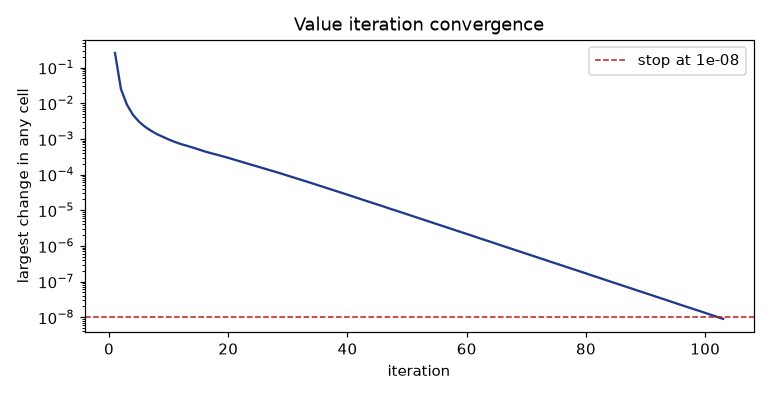
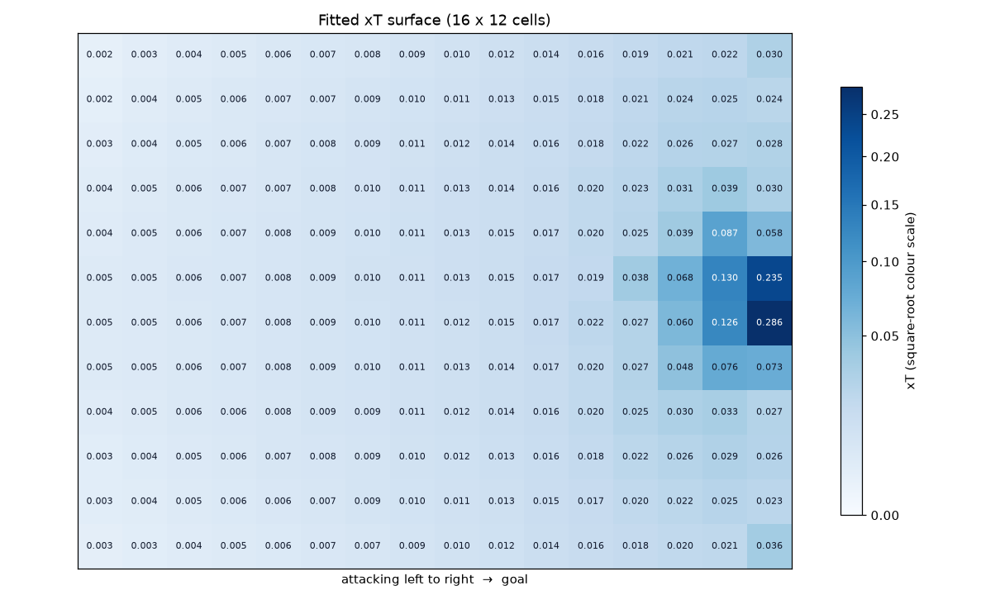

# Expected threat (xT): method and validation

Data: StatsBomb Open Data (statsbomb/open-data on GitHub), used under the StatsBomb Public Data User Agreement. Numbers below come from one run of `python scripts/fit_xt.py` on 2026-11-13 at commit be3cfde; the full record, including the max change at every iteration, is `data/xt_fit.json`.

## What the model is

Expected threat asks: if a team has the ball in this part of the pitch, how likely is it to score before it loses the ball? It is a Markov model on a grid (`core/xt.py`), after Karun Singh's description of xT.

- The pitch (105 x 68 m, the team attacking left to right) is cut into 16 columns along its length and 12 rows across it: 192 cells of about 6.6 x 5.7 m. The grid size is chosen by hand; it is the usual one.
- From the training actions, for each cell i:
  - shoot probability s_i = shots / (shots + moves), move probability m_i = moves / (shots + moves);
  - score probability g_i = goals / shots;
  - transition T_ij = completed moves from i that end in j / all moves from i. A failed move ends the chain, so each row of T sums to that cell's completion rate.
- The threat of a cell solves xT_i = s_i g_i + m_i sum_j T_ij xT_j. Value iteration starts from zero and repeats the right-hand side until no cell changes by more than 1e-8 (`xt_fit.tol`).

A move is a pass, completed or not, or a carry (StatsBomb carries never fail). A shot is any shot except a penalty, which comes from a fixed spot and would inflate one cell. Other events (dribbles, duels, clearances, ball receipts) are not actions in the model. The penalty shoot-out is excluded.

## Data and convergence

- Seasons and split: the same as the xG fit (`xg_fit` in `config.yaml`). Men's FIFA World Cup 2018 and 2022, UEFA Euro 2020 and 2024; 230 matches, of which 58 (25%, seed 7) are held out for testing. The surface is fitted on the 172 train matches only.
- Training actions: 326,079 moves (294,443 completed, 90.3%) and 4,203 non-penalty shots with 385 goals.
- Convergence: the largest change in any cell after each iteration. It falls by a factor of about 0.88 per iteration at the end, so the 1e-8 stop is reached after 103 iterations.

| iteration | max change |
|---|---|
| 1 | 0.257 |
| 2 | 0.0249 |
| 3 | 0.00914 |
| 5 | 0.00307 |
| 10 | 0.000965 |
| 20 | 0.000294 |
| 30 | 9.29e-05 |
| 50 | 7.69e-06 |
| 75 | 3.19e-07 |
| 103 | 8.99e-09 |

Figures: `python scripts/plot_xt.py` draws both from `data/xt_fit.json` (needs the `data` extra for matplotlib).

## The surface

Values run from 0.002 in the team's own corners to 0.286 in the cell straight in front of goal. They rise steadily along the pitch, and steeply only in the last three columns (about the depth of the penalty area). Outside the width of the goal, the byline column is lower than the column before it (0.030 against 0.039 in the fourth row), because shots from tight angles rarely score. The exact values are in `config.yaml` (`xt.surface`), which a test keeps equal to `data/xt_fit.json`.

## Validation on the held-out matches

xT is a prediction about the rest of the possession, so it is tested against that. For each of the 107,670 actions in the 58 test matches, the prediction is the xT of the cell where the action starts, and the outcome is whether the acting team scored (a non-penalty goal) later in the same StatsBomb possession. 1,653 actions (1.54%) were followed by a goal.

| prediction | log loss | Brier |
|---|---|---|
| xT | 0.0765 | 0.0149 |
| constant (train rate, 0.0167) | 0.0794 | 0.0151 |

Reliability: test actions sorted by xT and cut into ten bins of equal size.

| bin | actions | mean xT | observed goal rate |
|---|---|---|---|
| 1 | 10767 | 0.0048 | 0.0074 |
| 2 | 10767 | 0.0065 | 0.0072 |
| 3 | 10767 | 0.0078 | 0.0098 |
| 4 | 10767 | 0.0089 | 0.0113 |
| 5 | 10767 | 0.0102 | 0.0114 |
| 6 | 10767 | 0.0116 | 0.0163 |
| 7 | 10767 | 0.0134 | 0.0154 |
| 8 | 10767 | 0.0158 | 0.0195 |
| 9 | 10767 | 0.0197 | 0.0172 |
| 10 | 10767 | 0.0387 | 0.0379 |

Reading it: xT ranks positions in the right order (the observed rate rises from bin 1 to bin 10 with one dip) and beats the constant, but only by a little, since most single positions say little about a goal that is usually many actions away. It is too low in the lower bins: the mean prediction is 0.0137 against an observed 0.0154. A likely cause is that a failed pass or a lost duel ends the chain in the model, while a StatsBomb possession can survive it (a deflection back to a team-mate, a won second ball). Actions in one possession share an outcome, so the effective sample is much smaller than 10,767 per bin; small differences between neighbouring bins are noise.

## How PitchSide uses it

- **Metric.** `xt_added` (`core/metrics.py`) is, for a team or a player over a window, the sum over completed passes and carries of xT at the end point minus xT at the start. Moves backwards count, so it is net threat added. Failed passes, failed carries and shots are not counted. It is in the metric registry, so the verifier recomputes any xT claim from the event log with tolerance `verifier.tol_xt` (0.01, as claims state two decimals).
- **Moment.** At the end of each half, the player with the largest `xt_added` in that half gets a fact if it is at least `moments.xt_leader_min` (0.1, chosen by hand: in the synthetic match the leaders added about 0.3 per half). The text states only that player's own total, for example "U. Kerridge added 0.30 xT with completed passes and carries in the first half."; it does not say "most", because the verifier checks the number, not the ranking.
- **Analysis view.** A threat map per team: the surface as shading, and the team's five completed moves with the largest xT gain up to the replay clock. The front end draws the gains the bundle carries (`series.xt`); it computes none.
- The site's match is synthetic, so xT there is a model fitted on real tournaments applied to simulated passes and carries. The simulator was not tuned to this surface.

## Limits

- xT ignores defenders, pressure, team-mates' positions and everything off the ball. Two passes into the same cell are worth the same whatever the defence looked like.
- The values depend on the training data: men's international tournaments only. Club, women's or lower-level football may give a different surface.
- One surface for both directions of play and every game state; no left/right footedness, no set-piece split.
- Cells near the goal hold few actions, so their values are the least certain. There are no confidence intervals yet.
- One random split, no cross-validation.
- The replayed StatsBomb match (2018 final, match 8658) is in the training set, so xT on that replay is in-sample.
- xT is a model estimate. The verifier can check that an xT claim adds up the event log's moves on this surface correctly; it does not and cannot check that the surface is right.
